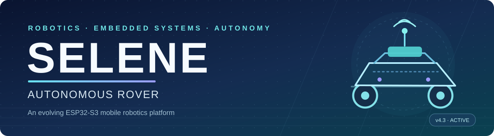
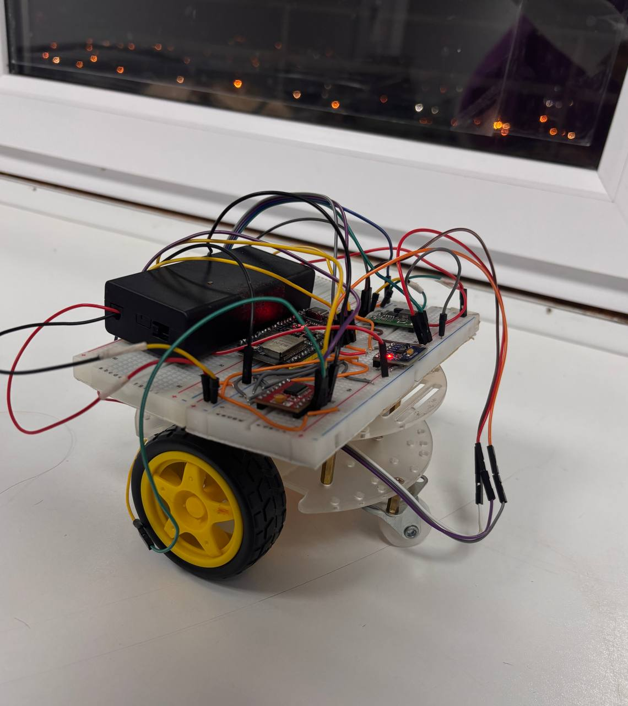
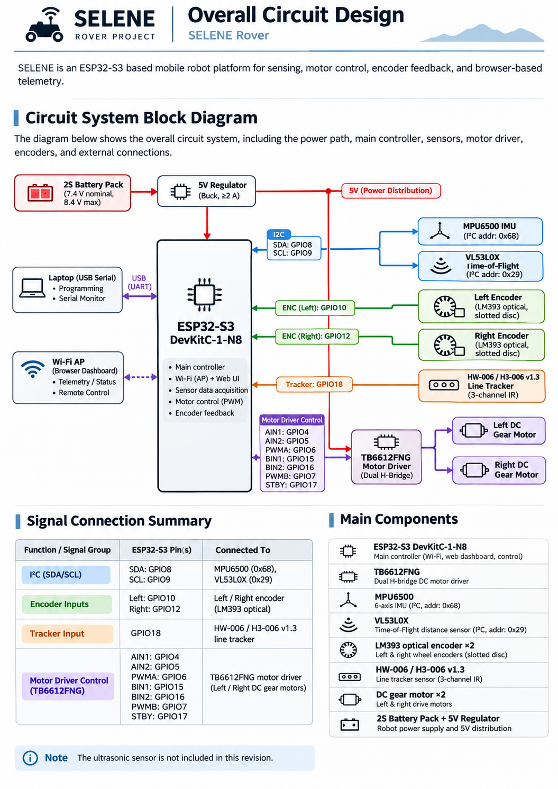
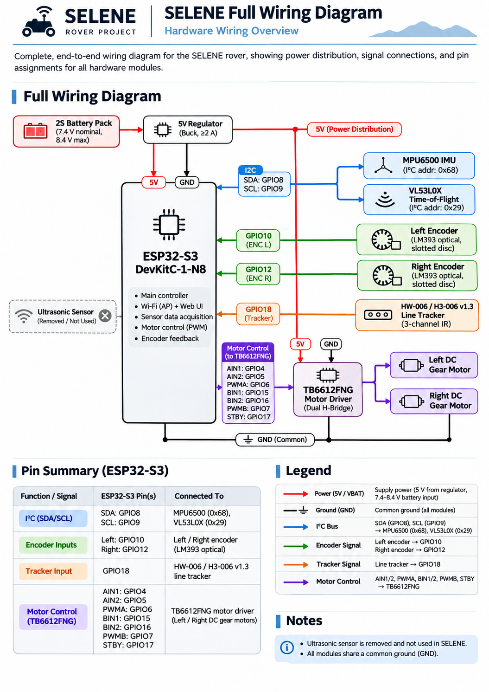
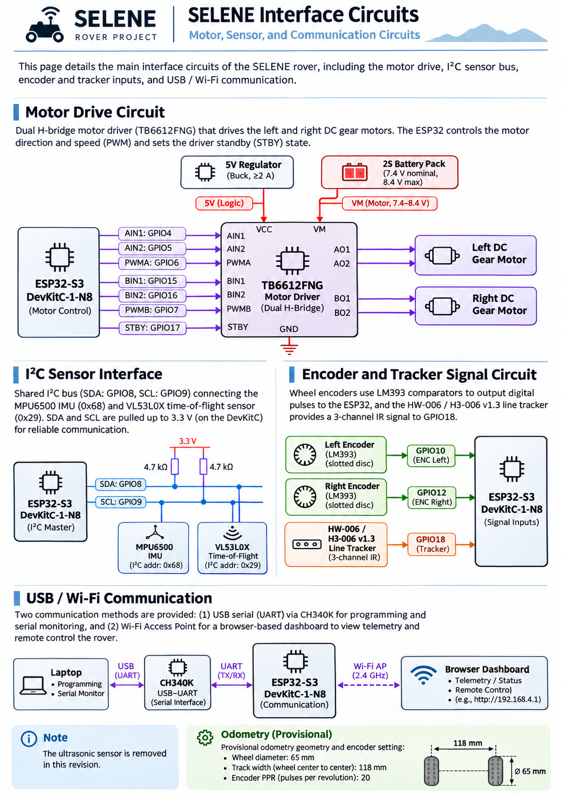
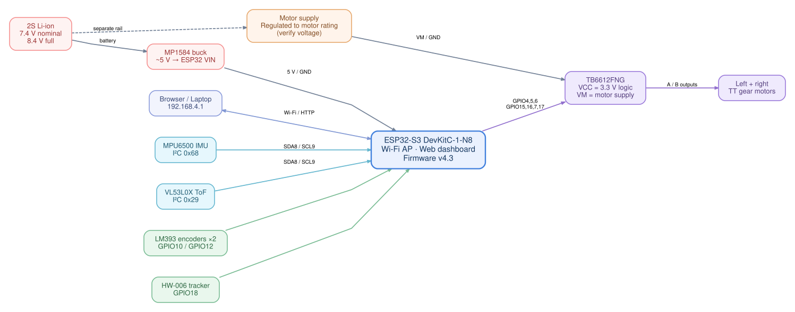

<p align="center">
  
</p>

# 🌙 SELENE — Autonomous Rover

### ESP32-S3 Differential-Drive Robotics Platform

**Sense. Control. Navigate.**

[GitHub Repository](https://github.com/Muhd-Mahmud/SELENE-Autonomous-Rover) · [Author Profile](https://github.com/Muhd-Mahmud) · [Issues](https://github.com/Muhd-Mahmud/SELENE-Autonomous-Rover/issues) · [Development Roadmap](docs/ROADMAP.md) · [Changelog](docs/CHANGELOG.md)

**SELENE** is a custom-built, two-wheeled mobile robot developed as an end-to-end embedded robotics project. It brings together **ESP32-S3 firmware, motor control, optical wheel encoders, inertial and distance sensing, wireless telemetry, and browser-based diagnostics**—with a development path toward reliable localization, obstacle avoidance, mapping, and autonomous navigation.

<p>
  
  
  
  
  
  
  
</p>

<p align="center">
  
  <br />
  <sub><b>SELENE · Physical prototype</b> — current breadboard-based hardware integration on a two-wheel acrylic chassis.</sub>
</p>

> [!NOTE]
> **Research status:** The pictured rover is a real, operating prototype—not a CAD render. Firmware v4.3 has functioning local Wi-Fi telemetry, MPU6500 readings, motor diagnostic pulses and wheel-encoder counts. **Odometry is provisionally configured but not yet physically calibrated; autonomous driving and SLAM are not implemented or enabled.**

---

## At a glance

| **Onboard intelligence** | **Perception & feedback** | **Mobility & access** |
|:--|:--|:--|
| ESP32-S3 DevKitC-1-N8 | MPU6500 6-axis IMU | 2WD differential-drive chassis |
| PlatformIO + Arduino/C++ | VL53L0X forward ToF | TB6612FNG dual H-bridge |
| Local web dashboard + JSON API | Dual LM393 optical encoders | 2 × TT DC gear motors |
| Wi-Fi access point | HW-006/H3-006 IR tracker | 2S battery + MP1584 buck |

### Engineering objectives

- **Build the platform:** design and validate a complete embedded sensing, power, and motor-control stack.
- **Measure its motion:** calibrate wheel encoder pulses, wheel geometry, straight-line travel, and turns.
- **Close the loop:** introduce safe wheel-speed feedback and differential-drive control.
- **Develop autonomy:** extend sensing and implement obstacle avoidance, mapping, localization, and navigation incrementally.

---

## System & circuit design

SELENE uses the **ESP32-S3** as its central controller. The rover reads the MPU6500 and VL53L0X over a shared I²C bus, receives single-channel optical encoder pulses, controls two motors through a TB6612FNG, and serves its dashboard directly from the microcontroller over Wi-Fi.

**Browse the three documented design views:** [Overall circuit](#01--overall-circuit-design) · [Full wiring](#02--full-wiring-diagram) · [Interface circuits](#03--interface-circuits)

> [!IMPORTANT]
> The three illustrated diagrams below are **system-design visualizations, not verified electrical schematics or PCB netlists**. Some generic labels in the artwork (such as **MPU6050** or **CH340K**) differ from the actual SELENE prototype (**MPU6500** and **CH343**). The pin assignment table and [hardware documentation](docs/HARDWARE.md) describe the observed build. In particular, **do not use a drawing's simplified motor power rail to justify powering 3–6 V motors directly from an 8.4 V fully charged 2S pack**.

### 01 · Overall circuit design

<p align="center">
  <a href="docs/assets/diagrams/selene-overall-circuit-design.png">
    
  </a>
  <br />
  <sub><b>Figure 1.</b> System-level control, sensing, and power architecture · click to view full resolution.</sub>
</p>

### 02 · Full wiring diagram

<p align="center">
  <a href="docs/assets/diagrams/selene-full-wiring-diagram.png">
    
  </a>
  <br />
  <sub><b>Figure 2.</b> Wiring and signal overview · use the verified pin map below for actual connections.</sub>
</p>

### 03 · Interface circuits

<p align="center">
  <a href="docs/assets/diagrams/selene-interface-circuits.png">
    
  </a>
  <br />
  <sub><b>Figure 3.</b> Motor control, I²C, encoder and communication interfaces · conceptual illustration.</sub>
</p>

<details>
<summary><b>Show the cleaner signal-level system architecture</b></summary>

<br />



This supplementary SVG separates the ESP32 supply from the **motor-rated VM supply**, and names the currently observed **MPU6500** and **CH343-compatible USB setup** in the associated hardware notes.

</details>

Full wiring reference: **[Hardware & GPIO map](docs/HARDWARE.md)** · **[Architecture notes](docs/ARCHITECTURE.md)** · **[Electrical & test safety](docs/SAFETY.md)**

---

## Hardware platform

| Module | Hardware / role | Development state |
|:--|:--|:--|
| **Controller** | ESP32-S3 DevKitC-1-N8 | Operational |
| **Motor driver** | TB6612FNG · dual H-bridge | Short raised-wheel pulses demonstrated |
| **Drive motors** | 2 × TT DC gear motors | Rotation confirmed |
| **Wheel feedback** | 2 × LM393 optical interrupters with slotted discs | Counts detected on both sides |
| **IMU** | MPU6500 · I²C `0x68` · WHO_AM_I `0x70` | Accel, gyro, and temperature telemetry working |
| **Distance** | VL53L0X · I²C `0x29` | Detected; ranging intermittently invalid |
| **Line tracking** | HW-006 / H3-006 v1.3 digital IR module | Connected to GPIO18 |
| **Power** | 2S lithium battery + MP1584 buck for controller | Motor rail rating must be verified |
| **Chassis** | Round acrylic 2WD frame | Physical prototype assembled |

### ESP32-S3 pin assignment

| Interface | Pin(s) | Connection |
|:--|:--|:--|
| I²C | `GPIO8` / `GPIO9` | SDA / SCL → IMU and ToF |
| Optical encoders | `GPIO10` / `GPIO12` | Left / right LM393 digital output |
| Line tracker | `GPIO18` | HW-006 digital output |
| Motor A | `GPIO4`, `GPIO5`, `GPIO6` | AIN1, AIN2, PWMA → left wheel |
| Motor B | `GPIO15`, `GPIO16`, `GPIO7` | BIN1, BIN2, PWMB → right wheel |
| Motor standby | `GPIO17` | TB6612FNG STBY |

**Power distinction:** TB6612FNG `VCC` is the logic supply, while `VM` supplies the motors. Grounds must be common. ESP32 GPIOs must not receive 5 V logic signals. Confirm the installed motor's allowable supply voltage before any powered drive test.

<details>
<summary><b>Experimental odometry configuration (v4.3)</b></summary>

| Measurement | Current setting | Status |
|:--|--:|:--|
| Wheel diameter | `65 mm` | Provisional |
| Outside-to-outside tire width | `143 mm` | Measured |
| Wheel-center spacing | `118 mm` | Estimated from 25 mm tire width |
| Encoder disc slots | `20` | Observed from disc photo |
| Effective pulses per **wheel** revolution | `20` | **Not verified**; assumes 1:1 disc/wheel rotation |

One-channel optical encoders count pulses but do not directly measure travel direction. The firmware's inferred direction and pose estimation are not a trustworthy navigation solution until validated.

</details>

---

## Mission Control · onboard dashboard

No cloud service, Raspberry Pi or external dashboard server is needed. SELENE creates its own Wi-Fi network and hosts a local browser UI on the ESP32-S3.

```text
Wi-Fi access point : SELENE_ROVER
Dashboard          : http://192.168.4.1/
Telemetry endpoint : http://192.168.4.1/api/state
```

The dashboard exposes **live motion data, ToF readings, IR status, encoder counts, odometry state, E-stop state, and guarded motor diagnostics**. The existing three-run encoder repeatability test is designed for **raised wheels only**.

```bash
# After connecting your computer to SELENE_ROVER:
curl -s http://192.168.4.1/api/state | python3 -m json.tool
```

---

## Development progress

| Capability | Status | Notes |
|:--|:--|:--|
| ESP32-S3 firmware + serial communication | **Working** | PlatformIO/Arduino |
| Self-hosted Wi-Fi dashboard | **Working** | Local HTTP telemetry |
| MPU6500 sensor acquisition | **Working** | Verified register-level reads |
| VL53L0X ranging | **Needs reliability work** | I²C communication confirmed; some readings invalid |
| LM393 wheel encoder inputs | **Bench-tested** | Both sides responding |
| Motor driver diagnostic pulses | **Bench-tested** | Raised wheels + arming interlock |
| Differential-drive odometry | **Experimental** | Geometry present, calibration incomplete |
| Wheel-speed PID + supervised floor movement | **Planned** | After motor power and encoder verification |
| Obstacle avoidance + mapping + SLAM | **Future work** | Requires more robust perception/localization |

### Roadmap

```text
STAGE 01  [████████░░]  Electronic bring-up & sensor integration
STAGE 02  [██░░░░░░░░]  Wheel geometry & odometry validation
STAGE 03  [░░░░░░░░░░]  Closed-loop differential drive
STAGE 04  [░░░░░░░░░░]  Obstacle detection & avoidance
STAGE 05  [░░░░░░░░░░]  Mapping, localization & navigation
```

The bars above are **illustrative milestone indicators**, not measured completion percentages. Detailed tests and acceptance criteria are tracked in the [living development roadmap](docs/ROADMAP.md).

---

## Repository structure

```text
SELENE-Autonomous-Rover/
├── .github/workflows/
│   └── firmware-build.yml       # Continuous integration
├── docs/
│   ├── assets/
│   │   ├── images/
│   │   │   └── selene-main-build.png
│   │   ├── diagrams/
│   │   │   ├── selene-overall-circuit-design.png
│   │   │   ├── selene-full-wiring-diagram.png
│   │   │   └── selene-interface-circuits.png
│   │   └── selene-banner.svg
│   ├── diagrams/                # Editable architecture source + SVG
│   ├── ARCHITECTURE.md
│   ├── HARDWARE.md
│   ├── SAFETY.md
│   ├── ROADMAP.md
│   ├── CHANGELOG.md
│   └── DEVELOPMENT.md
├── include/
│   └── selene_config.example.h # Public config template
├── scripts/                     # Setup, dashboard bundling, telemetry
├── src/
│   ├── main.cpp                 # Working firmware baseline
│   └── dashboard_html.h         # Embedded dashboard
├── tests/
├── web/
│   └── dashboard.html           # Editable web interface
├── platformio.ini
├── CONTRIBUTING.md
└── README.md
```

The actual `include/selene_config.h` is **local and git-ignored**, so credentials and machine-specific values are not published.

---

## Getting started

### Prerequisites

- ESP32-S3 board and confirmed-safe wiring/power supply
- VS Code with [PlatformIO](https://platformio.org/) or the `pio` CLI
- Python 3, USB data cable, and a computer with Wi-Fi

### Build and flash

```bash
# From the SELENE-Autonomous-Rover repository root:
python3 scripts/setup_local_config.py

# Set your own AP password in include/selene_config.h.
# Verify motor supply voltage; keep autonomous drive disabled.

python3 scripts/embed_dashboard.py
pio run -e selene_v4
pio run -e selene_v4 -t upload
```

Connect to the **`SELENE_ROVER`** Wi-Fi AP, then open **http://192.168.4.1/**. You can also inspect a telemetry snapshot with:

```bash
python3 scripts/telemetry_snapshot.py
```

> [!CAUTION]
> A 2S lithium-ion battery reaches **8.4 V when fully charged**. Many TT motors are rated for lower voltage. **Do not connect the pack directly to the motor supply pin unless your exact motors are rated for it.** Provide a motor-rated supply, secure the chassis, and keep a physical power disconnect. The software E-stop is not a replacement for hardware isolation. See [Safety](docs/SAFETY.md).

---

## Development log & collaboration

SELENE is developed as an **iterative engineering platform**: hardware experiments and measured results drive the next firmware release. Future changes will include commit history, photos, measurements and reproducible tests rather than unverified autonomy claims.

- [**Development guide**](docs/DEVELOPMENT.md) — building, flashing and updating the dashboard.
- [**Change history**](docs/CHANGELOG.md) — firmware and hardware milestones.
- [**Roadmap**](docs/ROADMAP.md) — implementation phases and outstanding tests.
- [**Contributing**](CONTRIBUTING.md) — reporting issues and proposing improvements.

**Suggested commit format:** `feat: add calibrated wheel speed feedback` · `fix: improve ToF error handling` · `docs: update wiring diagrams`

---

<p align="center">
  <b>SELENE · Autonomous Rover</b><br/>
  <i>A physical robotics prototype evolving from sensing and motor control toward autonomy.</i><br/><br/>
  Developed by <a href="https://github.com/Muhd-Mahmud">Muhammed Mahmud</a>
</p>
