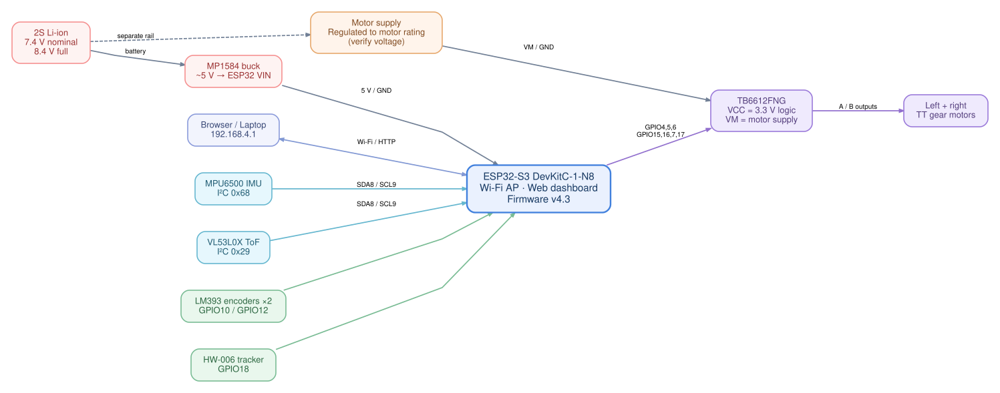
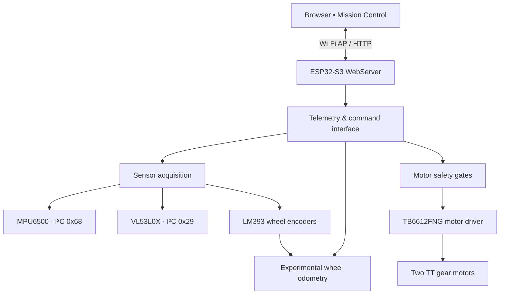

# System architecture

[← Back to README](../README.md) · [Wiring](HARDWARE.md) · [Roadmap](ROADMAP.md)

SELENE is currently an **ESP32-S3-controlled, two-wheel differential-drive research prototype**. The onboard controller hosts its own Wi-Fi access point and serves a browser-based Mission Control dashboard; no separate Python server is required for routine monitoring.



## Software layers



## Firmware design notes

- **Development:** C++ / Arduino framework / PlatformIO, environment `selene_v4`.
- **AP:** `SELENE_ROVER`; dashboard at `http://192.168.4.1/`.
- **Telemetry:** `GET /api/state` provides JSON state, sensor status, encoder counts and provisional odometry.
- **Motor commands:** existing guarded `POST /api/command` interface with arming, short raised-wheel tests and latched E-stop; see running code for exact accepted commands.
- **MPU6500:** identified by WHO_AM_I `0x70`; custom I²C register-burst read path. The decoder is named `decodeS16` to avoid the Arduino `word(...)` macro collision.
- **ToF:** VL53L0X availability and current measurement validity are different; `tof_present` can be true while `tof_ok` is false.
- **Odometry:** approximate x/y/yaw from wheel pulses and configured geometry. Encoder direction is inferred from the motor command, not measured from quadrature. The geometry is not validated.
- **Raised-wheel tests:** shaft pulses collected during TEST/CALIBRATING must not be treated as real chassis movement.

## Synchronizing the dashboard

Edit `web/dashboard.html`, then regenerate the embedded header:

```bash
python3 scripts/embed_dashboard.py
```

Both `web/dashboard.html` and `src/dashboard_html.h` should be committed when the dashboard changes. The generated header is checked into the repository so PlatformIO builds without an extra pre-build step.

## Out of scope today

Automatic path planning, SLAM, autonomous exploration, reliable obstacle avoidance, mapping, wheel speed PID and calibrated heading control are **not implemented or validated** in v4.3. These belong to the [roadmap](ROADMAP.md).
