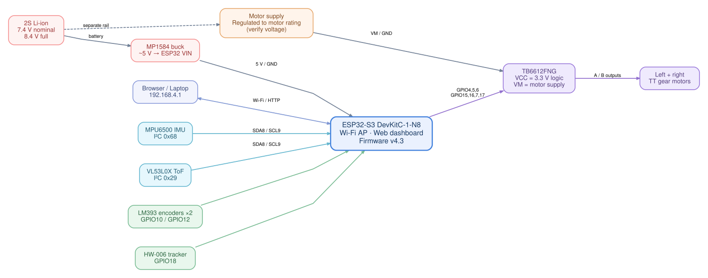

# Hardware & wiring

[← Back to README](../README.md) · [System design](ARCHITECTURE.md) · [Safety checks](SAFETY.md)

> [!CAUTION]
> This is a **documented wiring reference for the current prototype**, not a production-validated electrical schematic. Verify module pinouts and voltage compatibility against your actual boards before connecting power.

## Controller and power

- **MCU:** ESP32-S3 DevKitC-1-N8, Arduino framework under PlatformIO.
- **USB bridge:** CH343 USB-to-UART, typically `/dev/ttyACM0` on the current Linux setup. Port may change.
- **Battery:** two-cell lithium-ion pack; approximately 7.4 V nominal and **8.4 V fully charged**.
- **Controller regulator:** MP1584 buck converter adjusted to approximately 5 V for the ESP32 board's appropriate 5 V/VIN input (confirm the particular board input pin).
- **Motor driver:** TB6612FNG, dual H-bridge; `VCC` is logic voltage and `VM` is motor voltage. **Do not confuse them.**
- **Motor power:** should come from a supply compatible with the actual TT motors' ratings. An unregulated 2S pack can overvolt common 3–6 V TT motors. PWM does not make peak voltage safe.
- All signal grounds must share a common reference. ESP32 GPIOs are **not 5 V tolerant**.

## GPIO map

| Interface | ESP32-S3 GPIO | Target / connection |
|:--|:--|:--|
| I²C SDA | `GPIO8` | MPU6500 and VL53L0X |
| I²C SCL | `GPIO9` | MPU6500 and VL53L0X |
| Encoder left (digital) | `GPIO10` | LM393 D0, left wheel |
| Encoder right (digital) | `GPIO12` | LM393 D0, right wheel |
| Line tracker | `GPIO18` | HW-006 / H3-006 v1.3 digital OUT |
| TB6612 AIN1 | `GPIO4` | Left motor direction 1 |
| TB6612 AIN2 | `GPIO5` | Left motor direction 2 |
| TB6612 PWMA | `GPIO6` | Left motor PWM |
| TB6612 BIN1 | `GPIO15` | Right motor direction 1 |
| TB6612 BIN2 | `GPIO16` | Right motor direction 2 |
| TB6612 PWMB | `GPIO7` | Right motor PWM |
| TB6612 STBY | `GPIO17` | Driver standby control |
| Optional future servo | `GPIO21` (reserved) | Not installed / not active |

## Sensor inventory

| Device | Bus/address | Project status | Notes |
|:--|:--|:--|:--|
| MPU6500 IMU | I²C `0x68` | **Working** | Verified WHO_AM_I `0x70`; custom register driver |
| VL53L0X ToF | I²C `0x29` | **Intermittent** | I²C ACK present, but some samples return `tof_status: 2` and `tof_mm: -1` |
| Optical encoders ×2 | GPIO10 / GPIO12 | **Pulses detected** | LM393 with slotted disc, one channel per wheel |
| HW-006 tracker | GPIO18 | Input reported | Digital tracker; not currently used for autonomous navigation |
| TT gear motors ×2 | TB6612 A/B outputs | Bench-tested | Motor supply rating must be verified |
| Ultrasonic sensor | — | Removed | Not included in current setup |

## Experimental wheel geometry

| Parameter | Value | Basis |
|:--|--:|:--|
| Wheel diameter | **65 mm** | Matching chassis wheel specification; not measured directly |
| Outer-to-outer tire width | **143 mm** | Physical measurement |
| Wheel-center track width | **118 mm** | 143 mm less estimated 25 mm tire width |
| Optical disc slot count | **20** | Counted from disc photo |
| Encoder PPR | **20 (provisional)** | Only if disc rotates 1:1 with wheel and one rising edge/slot |

A raised-wheel test produced roughly **66 / 60 / 72** left pulses and **55 / 45 / 56** right pulses over three 350 ms motor bursts. **These numbers are NOT pulses per wheel revolution.**

## Documents / diagrams

For a precise electrical schematic, first confirm each module's actual board revision, supply voltage and connector pinout. The diagram is a **system-level block diagram**, not an electrical netlist.
